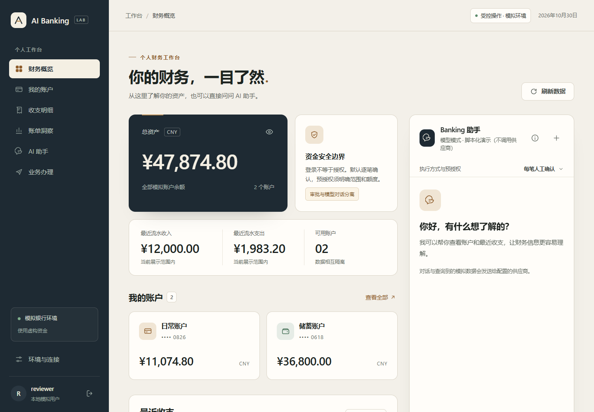
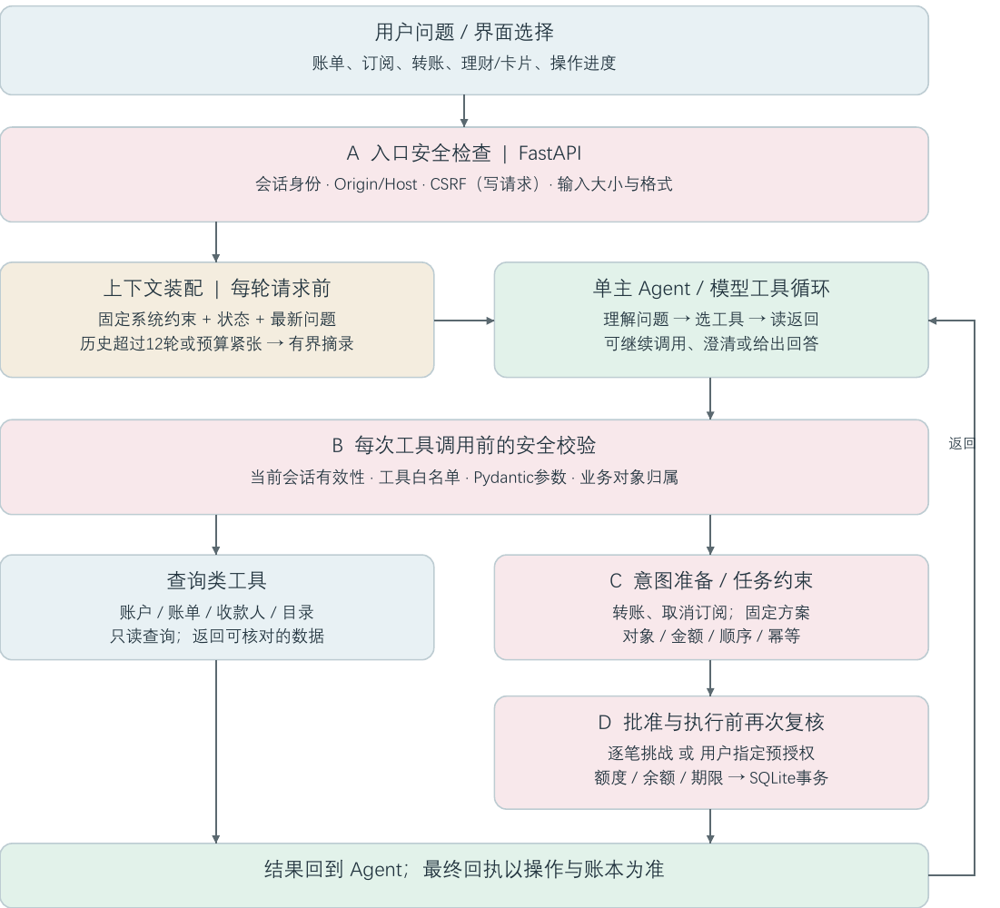

# AI-Banking

**先看清账目，再让Agent帮你完成下一步。**

AI-Banking 是一个可以在本机运行的模拟个人银行助手。你可以问“这个月的钱花在哪儿了”，核对疑似订阅，找到明确的收款人，再通过独立确认单完成模拟转账。它把自然语言交互和可核对的银行数据放在同一个工作台里。

## 为什么做这个项目

金融助手需要回答得清楚，也需要把事情做对。我们希望用户能看到分析依据、分清同名收款人、在付款前看懂影响，并在操作后核对真实状态。项目围绕“理解意图 → 查询依据 → 用户决定 → 受控执行 → 回执核对”构建一条完整路径。

## 可以做什么

| 你想做的事 | AI-Banking如何帮助你 |
| --- | --- |
| 看清收支 | 查看账户、流水、分类与区间对比，展开异常支出的原始依据 |
| 整理订阅 | 从周期支出发现线索，核对后登记管理，并独立确认取消 |
| 转给正确的人 | 按名称、备注或尾号查找收款人，同名时进一步确认 |
| 减少重复操作 | 预览“取消选定订阅后转固定金额”的方案，再逐步处理 |
| 管理模拟卡 | Agent仅查询脱敏卡片；申请、调额、冻结/解冻、挂失由界面发起，并需重新验证密码 |
| 跨场景计划 | 只保存日期与预算；创建时校验可用余额但不冻结/预占；临近时由用户手动点击按钮生成待确认操作 |
| 理财操作 | Agent仅查询/解释模拟数据；申购/赎回由界面发起并逐笔确认，不连接真实产品 |

所有资金、账户和联系人均为虚构，不连接真实银行或支付渠道。疑似订阅不是自动续费证明，取消不退款；未来减少的支出也不等于现在到账的钱。

## Agent怎样工作

用户提出问题后，服务端识别当前用户，装配问题、近期对话和银行状态。一个主Agent按需要组合12个工具，读取数据或提出操作意图，工具结果返回后再继续回答。

安全检查分布在请求入口、每次工具调用、任务准备和实际执行四个位置。模型不能创建授权或替用户批准。卡片、跨场景计划和理财的Agent能力限于查询/解释；相应写操作由界面发起。转账与订阅意图仍经独立确认，或在用户已设定的有效预授权范围内逐次复核。

上下文在每轮请求前按预算装配。默认保留最近12个成功回合，更早历史摘录；内容过长时会更早压缩。它不是固定每隔12轮运行一次的定时任务。资金状态和已完成步骤从后端恢复，不靠模型记忆判断。

跨场景日期计划不自动提醒或下单：只保存日期与预算，创建时按当时可用余额做校验，不预留资金；达到可操作时间后仍须用户在界面手动点击按钮，产生的转账操作再按确认链路处理。该计划与“取消用户选择的订阅后转固定金额”的多步骤工作流是两种不同能力。

## 界面预览





截图采用独立合成数据；涉及Agent闭环的截图保留脚本化演示标记。

## 第一次启动

需要Python 3.12+。项目采用FastAPI、SQLite和原生Web页面，不需要Node构建、外部数据库或Agent框架。

在源码根目录用PowerShell执行：
```powershell
python -m venv .venv
.\.venv\Scripts\python.exe -m pip install -e ".[dev]" -c requirements-dev.lock
if (-not (Test-Path .env)) { Copy-Item .env.example .env }
.\.venv\Scripts\python.exe -m ai_banking.auth.cli create-user demo_user
.\.venv\Scripts\python.exe -m ai_banking
```
终端会让你设置密码，没有默认账号密码。打开终端显示的地址，默认是http://127.0.0.1:8000，登录后即可进入工作台。保留已有.env，浏览器地址须与BANK_ORIGIN一致；端口冲突时修改该配置再重启，不要结束未知进程。

### 选择合适的启动方式

| 方式 | 适合什么情况 | 如何启动 |
| --- | --- | --- |
| 离线体验（默认） | 先查看工作台与本地规则查询 | .env保持AGENT_MODE=offline，不请求模型供应商 |
| 真实模型 | 体验自然语言理解、澄清和工具调用 | 配置AGENT_MODE=model、供应商HTTPS地址、协议、型号与服务端密钥后重启 |
| 可重复演示 | 重现材料中的订阅与转账界面 | 使用配套demo-environment.py；独立合成库和明确标注的脚本化Agent，不冒充真实模型 |

真实模型协议支持responses与chat，需要供应商支持函数工具；密钥只放服务端配置。终端正文轨迹默认关闭，调试时可显式设AGENT_TRACE_CONTENT=true；LangSmith默认关闭，可选启用，不能代替资金账本。旧库升级须先确认与备份，启动不会自动迁移。

## 建议这样体验

1. 从“财务概览”和“账单洞察”查看账户与收支，展开分类或异常依据。
2. 在“业务办理”核对疑似订阅；默认样本不足周期证据时，候选为空是正常现象。
3. 显式载入虚构联系人，比较两位张明的备注与尾号。
4. 选择订阅、付款账户、收款人和固定金额，预览资金影响后创建方案。
5. 逐笔核对并确认，最后查看后端任务进度与账本回执。

## 验证与项目边界

当前工作树自动化235项通过（含前端浏览器冒烟1项）。另在新建 Python 3.13 venv 按 `requirements-dev.lock` 安装 `.[dev]`，`pip check` 通过，核心与前端定向测试39项通过。Python 3.12是最低要求，但本机没有3.12解释器，未宣称已验证；上述环境结果不等于全新机器验收。列示的10项人工用例已由项目负责人确认审核通过，独立队友审查仍待完成。历史真实模型36条固定样本中35条结构断言通过、1条因输出预算未完成被保护拦截，不能转写为业务成功率；本轮未配置可用真实模型凭据，卡片、场景和理财专项真实模型评测未运行。

当前聚焦本地模拟与固定业务流程；不支持真实支付、后台定时转账、AA收款、生日资金冻结、外部预订或任意任务规划。人工审核与自动化通过不代表第三方安全审计、生产部署或监管认证。最低Python 3.12、其他操作系统、真实设备专项、独立队友审查及专项真实模型评测仍未完成。

## 文档与交付

- [部署指南](deployment-guide.md)：配置、端口排查、旧库与演示环境。
- [测试用例与人工审核结果](test-cases.md)：30项关键自动化映射、10项人工流程和当前235个实际自动化通过节点。
- [技术文档PDF](technical-document.pdf)与[安全自评PDF](security-self-assessment.pdf)仍为历史导出，修订后的[技术文档源稿](technical-document-source.md)与[安全自评源稿](security-self-assessment-source.md)尚未重导PDF；不要将当前PDF作为最终提交版。
- [源码与部署压缩包](source-and-deployment.zip)：历史归档快照，含代码、tests/、evals/和运行文档；并非当前冻结源码，正式提交前需按冻结版本重新打包和校验。

材料包含2026-10-30留存的代码与证据快照，来源基线和未提交增量以各自manifest为准，不等同于当前Git HEAD。正式提交前补齐团队姓名、分工和签署信息，完成独立队友审查，冻结版本，并确认PDF、PPTX、源码与截图一致。
